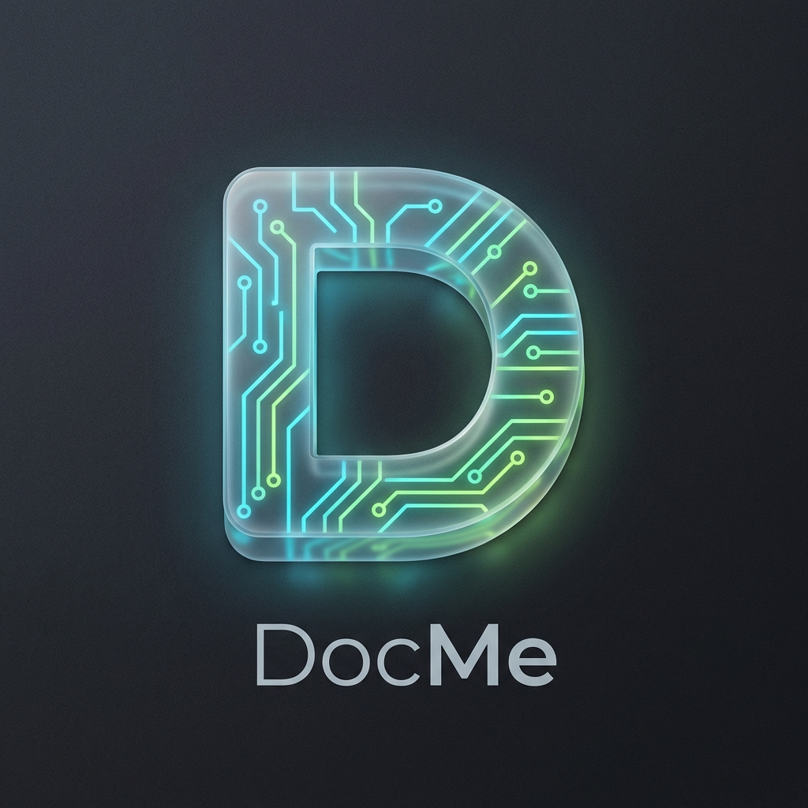

# DocMe - Privacy-First Activity Tracker

<div align="center">



**A beautiful, privacy-first activity tracker that runs entirely on your Mac.**

[](https://www.apple.com/macos/)

[Download Latest Release](https://github.com/LakshmidharKotipalli/DocMe/releases/latest) • [Installation Guide](INSTALL.md) • [Report Issue](https://github.com/LakshmidharKotipalli/DocMe/issues)

</div>

---

## ✨ Features

- 🖥️ **Native macOS App** - Beautiful menu bar integration with drag-to-position dashboard
- 🔒 **100% Private** - All data stays on your machine, never sent to any server
- 🤖 **AI-Powered Summaries** - Built-in LLM server with automatic model download from Hugging Face
- 📝 **Smart Quick Notes** - Non-intrusive popup for capturing thoughts without breaking flow
- 📊 **Beautiful Daily Reports** - Markdown summaries of your day's work and achievements
- 🔍 **Code Change Tracking** - Automatically detects and summarizes file modifications
- 🌓 **Premium UI** - Glassmorphism design with cyber lime accents and smooth animations
- ⚡ **Zero Configuration** - Works out of the box with SQLite, no database setup needed

---

## 🚀 Quick Start

### Option 1: Download Pre-built App (Recommended)

1. **Download** the latest `DocMe-1.0.0-arm64.dmg` from [Releases](https://github.com/LakshmidharKotipalli/DocMe/releases/latest)
2. **Open** the DMG and drag DocMe to Applications
3. **Launch** DocMe from Applications/Spotlight
4. **Grant Permissions** (see [Installation Guide](INSTALL.md))

### Option 2: Run from Source

#### Prerequisites
- **macOS**: 11.0 (Big Sur) or later
- **Node.js**: 18.0+ ([Download](https://nodejs.org/))
- **Python**: 3.11+ ([Download](https://www.python.org/))

#### Installation Steps

```bash
# 1. Clone the repository
git clone https://github.com/LakshmidharKotipalli/DocMe.git
cd DocMe

# 2. Set up Python environment
python3 -m venv .venv
source .venv/bin/activate

# 3. Install Python dependencies
pip install -r requirements.txt

# 4. Install frontend dependencies
cd frontend
npm install
cd ..
```

#### Running the Application

**Desktop Mode (Native App):**
```bash
python3 scripts/run_all.py --desktop
```

**Web Mode (Browser Dashboard):**
```bash
python3 scripts/run_all.py
```
Then open `http://localhost:5173` in your browser.

---

## ⚙️ Configuration

### AI Summaries

DocMe includes a built-in LLM server that automatically downloads models from Hugging Face.

1. **Open Settings** (gear icon in top-right)
2. **Toggle LLM On** - First activation downloads the model (~700MB)
3. **Change Model** (optional): Edit the model name to any GGUF-compatible repo

**Supported Model Formats:**
- Hugging Face repos: `ggml-org/gemma-3-1b-it-GGUF`
- Local GGUF files: Place in `llm/` directory

### Advanced Configuration

Edit `config/docme.yaml` for granular control:

```yaml
# Activity tracking
polling_interval_sec: 1.5
idle_threshold_sec: 300

# Privacy filters
excluded_apps:
  - "Keychain Access"
  - "1Password"
  
sensitive_keywords:
  - "password"
  - "bank"

# LLM settings
llm:
  model: "ggml-org/gemma-3-1b-it-GGUF"
  base_url: "http://localhost:8080/v1"

# Database (default: SQLite)
database:
  type: "sqlite"
  sqlite_path: "data/docme.sqlite"
```

---

## ⌨️ Keyboard Shortcuts

| Shortcut | Action |
|----------|--------|
| `Cmd+Shift+D` | Toggle Dashboard |
| `Cmd+Shift+N` | Quick Note Popup |
| `Cmd+G` | Generate Today's Report |
| `Cmd+E` | Export Data |

---

## 🏗️ Building from Source

### Create macOS DMG

```bash
python3 scripts/build_dist.py
```

Output: `frontend/release/DocMe-1.0.0-arm64.dmg`

### Project Structure

```
DocMe/
├── agent/              # Background activity tracker
├── backend/            # FastAPI server & processing
├── frontend/           # React + Electron UI
│   ├── electron/       # Electron main process
│   ├── src/            # React components
│   └── public/         # Static assets
├── config/             # Configuration files
├── scripts/            # Build & utility scripts
└── llm/                # LLM models directory
```

---

## 🛠 Troubleshooting

### Blank Page or No Data

**Check Permissions:**
1. Go to `System Settings → Privacy & Security`
2. Enable **Accessibility** for DocMe
3. Enable **Screen Recording** for DocMe

**Verify Backend:**
- Open Console.app
- Filter for "DocMe"
- Check for startup errors

### LLM Toggle Not Working

**First Time Setup:**
- Ensure internet connectivity (for model download)
- Wait 30-60 seconds for download to complete
- Check `~/Library/Application Support/DocMe/llm/` for cached models

**Manual Installation:**
- Download a GGUF model file
- Place in `llm/` directory in project root (for dev)
- Or `~/Library/Application Support/DocMe/llm/` (for packaged app)

### Backend Services Not Starting

**Check Python Dependencies:**
```bash
pip3 install uvicorn fastapi sqlalchemy psutil pytz loguru pyyaml
```

**View Detailed Logs:**
```bash
# For development
python3 scripts/run_all.py --desktop

# Check backend directly
cd backend
python3 -m uvicorn api.main:app --reload
```

---

## 🔧 Development

### Database Migrations

```bash
# Reset database (CAUTION: deletes all data)
python3 scripts/reset_docme.py

# Migrate schema
python3 scripts/migrate_db.py
```

### Hot Reload Development

```bash
# Terminal 1: Backend + Agent
python3 scripts/run_all.py

# Terminal 2: Frontend (dev server)
cd frontend
npm run dev

# Terminal 3: Electron (pointing to dev server)
npm run electron:dev
```

---

## 🤝 Contributing

Contributions are welcome! Please feel free to submit a Pull Request.

1. Fork the repository
2. Create your feature branch (`git checkout -b feature/AmazingFeature`)
3. Commit your changes (`git commit -m 'Add some AmazingFeature'`)
4. Push to the branch (`git push origin feature/AmazingFeature`)
5. Open a Pull Request

---

## 📄 License

This project is licensed under the MIT License - see the [LICENSE](LICENSE) file for details.

---

## 🙏 Acknowledgments

- Built with [Electron](https://www.electronjs.org/), [React](https://react.dev/), and [FastAPI](https://fastapi.tiangolo.com/)
- LLM integration powered by [llama.cpp](https://github.com/ggml-org/llama.cpp)
- Icons from [Lucide](https://lucide.dev/)
- Models from [Hugging Face](https://huggingface.co/)

---

<div align="center">

**Made with ❤️ for productivity and privacy**

[⬆ Back to Top](#docme---privacy-first-activity-tracker)

</div>
